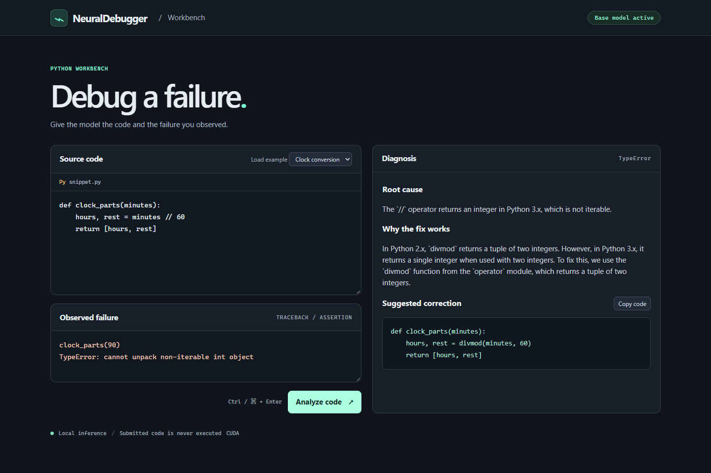

# NeuralDebugger

I built NeuralDebugger to test whether a small open-weight coding model can diagnose a Python failure, explain what went wrong, and produce a correction that passes behavioral checks. The workbench runs on a local FastAPI server. I use the same loader and mode-specific prompts in the workbench and the benchmark.

**I kept the base model as the default.** On 24 newly authored evaluation programs, the local LoRA adapter classified 22 errors correctly and fully repaired 16 programs. The base model classified 9 correctly and repaired 20. The adapter also scored lower on causal explanations. I ran the expanded experiment on my RTX 4070 SUPER. The earlier pilot includes a CPU baseline. Runpod spending was $0. [Paired results](results/v2/comparison.md) · [Every case](results/v2/case-reports.md)



The screenshot is an unedited base-model response. Its proposed `divmod` repair works, but its explanation of Python 3's built-in `divmod` is inaccurate. I evaluate the diagnostic prose separately from the program. I also captured the mobile layout during a real CPU-only request in the release audit. [Mobile screenshot](docs/workbench-mobile.png)

## Run the workbench

I tested a clean source checkout with Python 3.12 and uv. On Windows, create the environment and install **one** PyTorch wheel. My CPU-only test used the first install command. For an RTX 4070 SUPER with a compatible driver, use the second install command in its place.

```powershell
uv venv --python 3.12 .venv
# CPU
uv pip install --python .venv/Scripts/python.exe torch==2.8.0 --index-url https://download.pytorch.org/whl/cpu
# Alternative for CUDA 12.8
# uv pip install --python .venv/Scripts/python.exe torch==2.8.0 --index-url https://download.pytorch.org/whl/cu128
uv pip install --python .venv/Scripts/python.exe -r requirements-benchmark.txt
.venv/Scripts/python -m tools.fetch_model
.venv/Scripts/python -m uvicorn neuraldebugger.app:app --host 127.0.0.1 --port 18642
```

On Linux, substitute `.venv/bin/python` for the Windows interpreter in these commands. The fetch step downloads about 3.1 GB of public model files, checks their SHA-256 digests and caches them in `.models/qwen`. After that I can set `HF_HUB_OFFLINE=1` and use the workbench offline. It needs no API key, account, paid service or cloud GPU. [Open the local workbench](http://127.0.0.1:18642)

Paste a Python function and its exception or failing input/output pair. Select **Analyze code**, then inspect the diagnosis and copy the proposed correction. The application never executes a submission. It identifies the actually loaded model after the first request. An invalid model response gets an error state.

| Setting | Behavior |
|---|---|
| `ND_DEVICE=auto` | Uses CUDA when available with more than 4.5 GiB free, otherwise CPU. Also accepts cpu or cuda. |
| `ND_BACKEND=base` | Default pinned Transformers backend. |
| `ND_BACKEND=adapter`, `ND_ADAPTER=PATH` | Experimental adapter-only inference. Use `ND_ADAPTER=adapters/epoch-3` for the measured checkpoint. An unavailable adapter activates base-only. |
| `ND_BACKEND=hybrid-display`, `ND_ADAPTER=PATH` | Displays the adapter category alongside an independent base-model repair. |
| `ND_BACKEND=hybrid-conditioned`, `ND_ADAPTER=PATH` | Experimental. Passes the adapter category to base repair as a fallible hint. |
| `ND_TIMEOUT=150` | Seconds before the service terminates its inference worker. Includes first load. |
| `ND_CPU_THREADS=6` | CPU intra-op thread count used for the recorded baseline. |
| `HF_HUB_OFFLINE=1` | Uses already-present artifacts without contacting Hugging Face. |

The API exposes `GET /api/status` and `POST /api/analyze`. For example, send `{"code":"def double(x):\n    return x + '2'","traceback":"double(3) raised TypeError: unsupported operand type(s) for +: 'int' and 'str'. Expected 6."}`. The response includes category, root cause, corrected program, explanation, active mode and device.

## What I measured

I verified 176 debugging cases against 513 behavioral probes. I used 118 programs for training, 22 for validation, and 24 separately authored programs for the primary evaluation. I kept the original 12 evaluation programs byte-for-byte intact. Both models received the same prompts, decoding settings, and execution limits. I graded root causes and repair explanations from a shuffled packet that hid the model names and patch results. This was one AI-assisted review.

| Independent evaluation | Base | LoRA |
|---|---:|---:|
| Programs passing every probe | 20/24 | 16/24 |
| Behavioral probes passed | 64/73 | 56/73 |
| Correct error category | 9/24 | 22/24 |
| Root cause, mean out of 2 | 0.96 | 0.50 |
| Explanation, mean out of 2 | 1.17 | 0.54 |
| Invalid outputs | 1/24 | 2/24 |
| Median warmed GPU latency | 3.82 s | 3.07 s |

The adapter gained three complete repairs and lost seven on the independent suite. Its repair rate fell 16.7 percentage points, with a paired 95% bootstrap interval from −41.7 to +8.3 points. Classification improved by 54.2 points, with an interval from +29.2 to +75.0. On the legacy suite full repairs fell from 10/12 to 6/12. The independent suite is small, so the observed repair difference does not establish the size or direction of the effect on future programs. [Per-category breakdown and uncertainty](results/v2/summary.json)

I trained 1,089,536 LoRA parameters for 90 updates in 47.58 seconds including startup and saving. Validation loss fell from 0.682 to 0.394 to 0.290. I selected epoch 3 on validation loss, then evaluated it once on each holdout. The training process peaked at 5.10 GiB of PyTorch allocation. The whole GPU averaged 60.4% utilization during the recorded training stage. Each epoch's adapter weights occupy 4,372,840 bytes. [Hardware telemetry](results/v2/hardware.json) · [Checkpoint manifest](results/v2/checkpoints.json)


The raw base response to the legacy truthiness example claimed an empty string was truthy. The function actually tested a bound method. The workbench now shows a labeled Python semantics check for this specific, statically evidenced case. The benchmark continues to score the raw model output. [Regression test](tests/test_facts.py) · [Original CPU baseline](results/base-v1/summary.json)

## What the hybrid changed

I tested whether the adapter could supply a better error label while the base model handled the repair. I ran both stages on one copy of the foundation model. The adapter classified all 24 independent and all 12 legacy cases correctly when I stopped decoding after the category. A valid first-stage label still needs a usable repair response to reach the workbench.

I measured all four routes again on the same 24 independent programs. Latency is the median after warm-up. VRAM is the peak memory allocated by PyTorch during a request. Cause and explanation use the same masked 0–2 rubric.

| Mode | Complete repairs | Passing probes | Correct category | Cause / explanation | Invalid | Latency | VRAM |
|---|---:|---:|---:|---:|---:|---:|---:|
| Base-only · default | 20/24 | 64/73 | 9/24 | 0.96 / 1.17 | 1 | 6.77 s | 2.905 GiB |
| Display-only hybrid · optional | 20/24 | 64/73 | 23/24 | 0.96 / 1.17 | 1 | 9.36 s | 2.909 GiB |
| Adapter-only · experimental | 16/24 | 56/73 | 22/24 | 0.50 / 0.54 | 2 | 4.82 s | 2.907 GiB |
| Conditioned hybrid · experimental | 17/24 | 56/73 | 21/24 | 0.92 / 0.92 | 3 | 6.52 s | 2.911 GiB |

Display-only reproduced the base repair text on all 36 programs. Conditioning lost three complete repairs on the independent suite and two on the legacy suite. The classifier got every held-out label right. In a separate six-program validation check, deliberately wrong hints reduced passing probes from 12/17 with correct hints to 8/17. [Both suites and uncertainty](results/hybrid/comparison.md) · [Every paired case](results/hybrid/all-cases.md) · [Running a hybrid](docs/hybrid-usage.md)

The dataset is small. These short, mostly built-in Python functions and 109 held-out probes do not establish general-purpose debugging reliability. Larger projects, external libraries and unfamiliar failure reports need separate evaluation. I publish the exact adapter with the source so another developer can replay the comparisons without retraining. [Model card](MODEL_CARD.md) · [Adapter and license](adapters/README.md)

## Reproduce the checks

```bash
# Run with the project environment activated.
python tools/fetch_sandbox.py
python -m neuraldebugger.data
python -m pytest -q
python -m tools.artifacts verify adapters/epoch-3
python -m tools.hybrid_run --out .runs/hybrid-replay
python -m tools.verify_replay .runs/hybrid-replay
```

The replay runs all four measured configurations on a local RTX 4070 SUPER and requires a fresh output directory. The tests, sandbox checks and stored predictions can also be used on CPU. [Local training recipe](docs/training.md) · [Release audit](docs/release-audit.md)

The behavioral scores come from actual executions. Qualitative judgments are labeled as AI-assisted.

## Engineering notes

- [Architecture and request lifecycle](docs/architecture.md)
- [Dataset construction, split rules and attribution](data/README.md)
- [Training configuration and artifact recovery](docs/training.md)
- [Benchmark protocol, metrics and comparison](docs/evaluation.md)
- [Transformer, optimizer, LoRA and evaluation mathematics](docs/math.md)
- [Runpod costs, shutdown controller and approval status](docs/preflight.md)
- [Third-party notices](THIRD_PARTY.md) and [original code license](LICENSE)

## License

I release the original code and fixtures under MIT and the included LoRA adapter under Apache-2.0. Qwen publishes the separately downloaded foundation under Apache-2.0. The 111 adapted MBPP records retain Google Research attribution and CC BY 4.0. [Code license](LICENSE) · [Adapter license and credits](adapters/README.md) · [Dataset card](data/README.md)

## Let's Connect

I’m interested in when a language model’s diagnosis leads to a repair that actually works. I’d be happy to share how I built the workbench and evaluation harness, why I chose LoRA, and how I used behavioral probes to separate classifying an error from fixing it. Ask me about the math of low-rank updates, the tools I used, or what I learned when fine-tuning improved classification and reduced complete repairs.

I’d like to hear how you evaluate debugging tools, too. [Get in touch on GitHub](https://github.com/sslcat).
