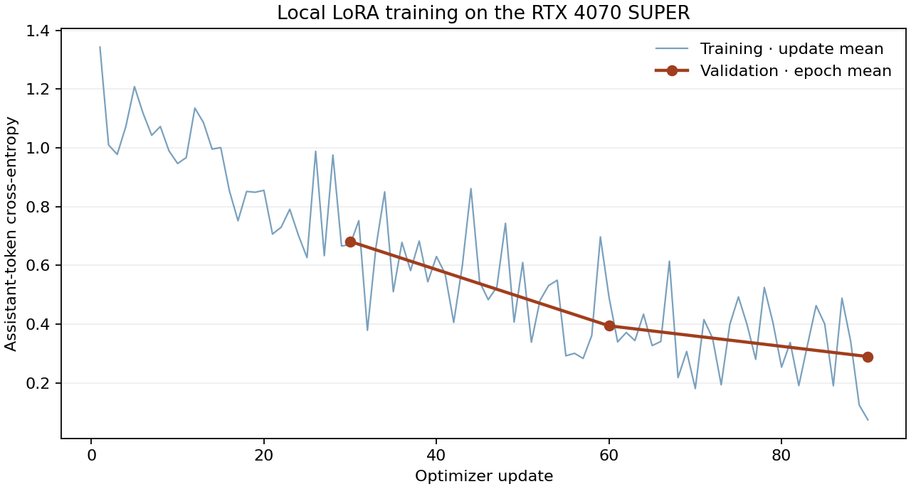

# NeuralDebugger

I built NeuralDebugger to test whether a small open-weight coding model can diagnose a Python failure, explain what went wrong, and produce a correction that passes behavioral checks. The workbench runs on a local FastAPI server. The same model loader and prompt power the benchmark.

**I kept the base model as the default.** On 24 newly authored evaluation programs, the local LoRA adapter classified 22 errors correctly and fully repaired 16 programs. The base model classified 9 correctly and repaired 20. The adapter also scored lower on causal explanations. All training and evaluation ran on my RTX 4070 SUPER. Runpod spending was $0. [Paired results](results/v2/comparison.md) · [Every case](results/v2/case-reports.md)


The screenshot is an unedited base-model response. Its proposed `divmod` repair works, but its explanation of Python 3's built-in `divmod` is inaccurate. I evaluate the diagnostic prose separately from the program.

## Run the workbench

I used Python 3.12.15. From this checkout, install the pinned dependencies into an isolated environment. For CPU-only operation, install the CPU wheel for PyTorch first. For CUDA, choose the wheel matching the installed driver. My exact Windows package inventory is included. [Windows environment](configs/windows-environment.txt)

```powershell
uv venv --python 3.12 .venv
uv pip install --python .venv/Scripts/python.exe torch==2.8.0 --index-url https://download.pytorch.org/whl/cu128
uv pip install --python .venv/Scripts/python.exe -r requirements-benchmark.txt
.venv/Scripts/python -m uvicorn neuraldebugger.app:app --host 127.0.0.1 --port 18642
```

On Linux or macOS, use `.venv/bin/python`. Open [the local workbench](http://127.0.0.1:18642). The first analysis loads the public pinned model, approximately 3.1 GB of weights. This checkout can also use the downloaded snapshot under `.models/qwen`. I run it offline once the snapshot is present. No paid inference API is required.

Paste a Python function and its exception or failing input/output pair. Select **Analyze code**, then inspect the diagnosis and copy the proposed correction. The application never executes a submission. It identifies the actually loaded model after the first request. An invalid model response gets an error state.

| Setting | Behavior |
|---|---|
| `ND_DEVICE=auto` | Uses CUDA when available with more than 4.5 GiB free, otherwise CPU. Also accepts cpu or cuda. |
| `ND_BACKEND=base` | Default pinned Transformers backend. |
| `ND_BACKEND=adapter`, `ND_ADAPTER=PATH` | Loads a PEFT checkpoint with matching NeuralDebugger metadata. Reports fallback if unavailable. |
| `ND_BACKEND=hybrid-display`, `ND_ADAPTER=PATH` | Displays the adapter category alongside an independent base-model repair. |
| `ND_BACKEND=hybrid-conditioned`, `ND_ADAPTER=PATH` | Also passes the adapter category to the base repair as a fallible hint. |
| `ND_TIMEOUT=150` | Seconds before the service terminates its inference worker. Includes first load. |
| `ND_CPU_THREADS=6` | CPU intra-op thread count used for the recorded baseline. |
| `HF_HUB_OFFLINE=1` | Uses already-present artifacts without contacting Hugging Face. |

The API exposes `GET /api/status` and `POST /api/analyze`. For example, send `{"code":"def double(x):\n    return x + '2'","traceback":"double(3) raised TypeError: unsupported operand type(s) for +: 'int' and 'str'. Expected 6."}`. The response includes category, root cause, corrected program, explanation, active mode and device.

## What I measured

I verified 176 debugging cases against 513 behavioral probes. I used 118 programs for training, 22 for validation, and 24 separately authored programs for the primary evaluation. I kept the original 12 evaluation programs byte-for-byte intact. Both models received the same prompts, decoding settings, and execution limits. I graded root causes and repair explanations from a shuffled packet that hid the model names and patch results. This was one AI-assisted review.

| Independent evaluation | Base | LoRA |
|---|---:|---:|
| Programs passing every probe | 20/24 | 16/24 |
| Behavioral probes passed | 64/73 | 56/73 |
| Correct error category | 9/24 | 22/24 |
| Root cause, mean out of 2 | 0.96 | 0.50 |
| Explanation, mean out of 2 | 1.17 | 0.54 |
| Invalid outputs | 1/24 | 2/24 |
| Median warmed GPU latency | 3.82 s | 3.07 s |

The adapter gained three complete repairs and lost seven on the independent suite. Its repair rate fell 16.7 percentage points, with a paired 95% bootstrap interval from −41.7 to +8.3 points. Classification improved by 54.2 points, with an interval from +29.2 to +75.0. On the legacy suite full repairs fell from 10/12 to 6/12. The independent suite is small, so the observed repair difference does not establish the size or direction of the effect on future programs. [Per-category breakdown and uncertainty](results/v2/summary.json)

I trained 1,089,536 LoRA parameters for 90 updates in 47.58 seconds including startup and saving. Validation loss fell from 0.682 to 0.394 to 0.290. I selected epoch 3 on validation loss, then evaluated it once on each holdout. The training process peaked at 5.10 GiB of PyTorch allocation. The whole GPU averaged 60.4% utilization during the recorded training stage. Each epoch's adapter weights occupy 4,372,840 bytes. [Hardware telemetry](results/v2/hardware.json) · [Checkpoint manifest](results/v2/checkpoints.json)



The raw base response to the legacy truthiness example claimed an empty string was truthy. The function actually tested a bound method. The workbench now shows a labeled Python semantics check for this specific, statically evidenced case. The benchmark continues to score the raw model output. [Regression test](tests/test_facts.py) · [Original CPU baseline](results/base-v1/summary.json)

## What the hybrid changed

I tested whether the adapter could supply a better error label while the base model handled the repair. I ran both stages on one copy of the foundation model. The adapter classified all 24 independent and all 12 legacy cases correctly when I stopped decoding after the category. A valid first-stage label still needs a usable repair response to reach the workbench.

On the independent suite, displaying the label alongside an ordinary base repair gave 23/24 correct end-to-end categories, 20/24 complete repairs and 64/73 passing checks. Feeding that same label back into the repair prompt gave 21/24 correct categories, 17/24 complete repairs and 56/73 passing checks. On the legacy suite, the two hybrids repaired 10/12 and 8/12 respectively. I kept base-only as the default. I use display-only when the category itself matters. [Four-arm comparison](results/hybrid/comparison.md) · [Every paired case](results/hybrid/all-cases.md) · [Running a hybrid](docs/hybrid-usage.md)

On the independent suite, base-only and display-only both scored 0.96/2 for root cause and 1.17/2 for explanation. Conditioning scored 0.92/2 on each. Display-only took a median 9.36 seconds against 6.77 seconds for base-only in this run. Peak PyTorch allocations were 2.909 and 2.905 GiB respectively. I saw zero natural classifier mistakes across these small suites. In a separate six-program validation check, deliberately wrong hints reduced passing probes from 12/17 with a correct hint to 8/17.

## Reproduce the checks

```bash
python tools/fetch_sandbox.py
python -m neuraldebugger.data
python -m pytest -q
python -m neuraldebugger.report finish
```

I used AI coding assistance from OpenAI Codex to implement the application, write and check fixtures, run experiments, draft documentation and review model responses. The behavioral scores come from actual executions. Qualitative judgments are labeled as AI-assisted.

## Engineering notes

- [Architecture and request lifecycle](docs/architecture.md)
- [Dataset construction, split rules and attribution](data/README.md)
- [Training configuration and artifact recovery](docs/training.md)
- [Benchmark protocol, metrics and comparison](docs/evaluation.md)
- [Transformer, optimizer, LoRA and evaluation mathematics](docs/math.md)
- [Runpod costs, shutdown controller and approval status](docs/preflight.md)
- [Third-party notices](THIRD_PARTY.md) and [original code license](LICENSE)

## Let's Connect

I'm happy to discuss the implementation, training methodology, experiments and results. [Find me on GitHub](https://github.com/sslcat)
